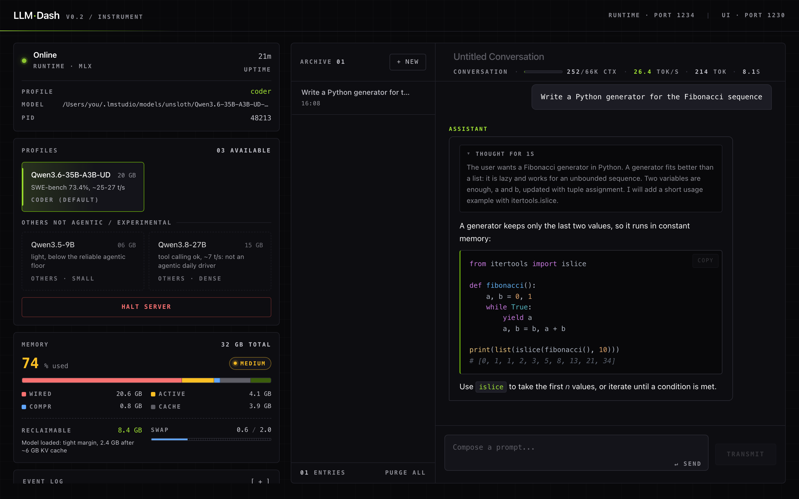

# LLM Dash

[English](README.md) · **Italiano**

Un control plane e una dashboard web per far girare LLM locali su Apple Silicon con `mlx_lm.server`: profili di modello con un nome, cambio di modello con un clic, un monitor della pressione di memoria e una chat in streaming che mostra il ragionamento del modello.



## Perché esiste

Su un Mac da 32 GB entra un solo modello da 16-20 GB alla volta, e se gira bene dipende da memoria che dal terminale non si vede: wired, compressa, swap. `mlx_lm.server` è il runtime più veloce qui (circa il 5-15% in più di LM Studio sugli stessi pesi, vedi [docs/ARCHITECTURE.md](docs/ARCHITECTURE.md)), ma non gestisce i modelli e non ha una UI.

LLM Dash aggiunge il pezzo che manca:

- **Profili** in un solo file TOML: path del modello, contesto, tier, argomenti del chat template (per esempio `enable_thinking`). Lo stesso file guida gli script di shell, la dashboard e la configurazione di opencode.
- **Cambio di modello** dal browser o dal terminale, con un modello caricato alla volta.
- **Memoria**: la scomposizione fra wired, attiva, compressa, inattiva e libera, con il livello di pressione di macOS e lo swap.
- **Chat**: Markdown in streaming con evidenziazione della sintassi, il ragionamento del modello in un riquadro richiudibile, conversazioni salvate nel browser.

Quanto regge questo setup nel coding agentico è stato misurato in un repository separato, **[local-llm-eval](https://github.com/essedev/local-llm-eval)**: quali modelli tengono un loop agentico, dove la quantizzazione a 4 bit inizia a corrompere l'output, come se la cava un modello locale contro quelli cloud su task piccoli. Sintesi in [docs/EVALS.md](docs/EVALS.md).

## Requisiti

- Mac Apple Silicon. Costruito e misurato su un MacBook Pro M5 da 32 GB, macOS 26 Tahoe.
- [uv](https://docs.astral.sh/uv/) e `mlx-lm`: `uv tool install mlx-lm`.
- [pnpm](https://pnpm.io/) per buildare il CSS.
- Modelli MLX in `~/.lmstudio/models/` (scaricati con LM Studio o `huggingface-cli`). La cartella è `server.models_dir` in `config/llm-dash.toml`.
- Facoltativi: tmux (`llm-up` avvia il server in una sessione tmux se c'è), [opencode](https://opencode.ai) come coding agent.

## Installazione

```bash
make setup                   # symlink degli script di bin/ in ~/.local/bin + build del CSS

# Limite della wired memory, una volta sola (serve sudo)
sudo sysctl iogpu.wired_limit_mb=28000
# Persistente ai riavvii:
sudo cp config/com.local.wired-limit.plist /Library/LaunchDaemons/
sudo launchctl load /Library/LaunchDaemons/com.local.wired-limit.plist

# opencode, facoltativo: sostituisci /Users/you con la tua home
cp config/opencode.json.example ~/.config/opencode/opencode.json
```

Poi metti i tuoi modelli in `config/llm-dash.toml`. I profili nel repo sono quelli dell'autore; `docs/MODEL_SYNC.md` è un prompt con cui un coding agent riallinea il TOML, la config di opencode e la documentazione ai modelli davvero presenti su disco.

## Uso

```bash
llm-up                       # avvia il profilo di default sulla porta 1234
llm-dash --bg                # avvia la dashboard sulla porta 1230
open http://127.0.0.1:1230
```

| Comando | Cosa fa |
|---|---|
| `llm-up [profile]` | Avvia `mlx_lm.server` con un profilo (default: `server.default_profile`) |
| `llm-switch <profile>` | Cambia modello (kill + restart) |
| `llm-down` | Ferma il server LLM |
| `llm-dash` | Dashboard in foreground |
| `llm-dash --bg` | Dashboard in background |
| `llm-dash stop` | Ferma la dashboard |
| `make models` | Elenca i profili |
| `make help` | Tutti i target del Makefile |

Ogni profilo espone un'API compatibile con OpenAI su `http://127.0.0.1:1234/v1`.

## Documentazione

| Documento | Contenuto |
|---|---|
| [docs/ARCHITECTURE.md](docs/ARCHITECTURE.md) | Decisioni tecniche: mlx_lm contro LM Studio, un modello alla volta, SSE contro WebSocket |
| [docs/DASHBOARD.md](docs/DASHBOARD.md) | Stack della UI, endpoint, render in streaming, classi CSS |
| [docs/MODELS.md](docs/MODELS.md) | Catalogo dei modelli per tier, classifiche, benchmark |
| [docs/MODEL_SYNC.md](docs/MODEL_SYNC.md) | Prompt per un coding agent che riallinea modelli su disco e config |
| [docs/MEMORY.md](docs/MEMORY.md) | available contro used, KV cache, swap, budget di headroom |
| [docs/HARDWARE.md](docs/HARDWARE.md) | M5, memoria unificata, Neural Accelerators, limite wired |
| [docs/OPENCODE.md](docs/OPENCODE.md) | Integrazione con opencode, provider mlx |
| [docs/RUNBOOK.md](docs/RUNBOOK.md) | Workflow quotidiano, troubleshooting, recovery |
| [docs/EVALS.md](docs/EVALS.md) | Esperimenti sui limiti reali di questo setup |
| [docs/CONVENTIONS.md](docs/CONVENTIONS.md) | Lingua, glossario, convenzioni del codice |

La documentazione è in inglese.

## Stack

- **Backend**: Python 3.12 con uv, FastAPI, uvicorn, httpx, psutil, sse-starlette, Jinja2.
- **Frontend**: Tailwind CSS v4 (CSS-first via `@theme`), Alpine.js 3.14, marked, highlight.js, serviti come file statici senza bundler JS.
- **Runtime LLM**: mlx-lm 0.31 su Apple MLX.

## Stato

Uno strumento personale, usato ogni giorno su una macchina e condiviso come riferimento. Dà per scontati macOS, Apple Silicon e i path qui sopra; non ci sono release né test automatici.

## Licenza

[MIT](LICENSE). Alpine.js, marked e highlight.js inclusi nel repo mantengono le loro licenze, elencate in testa a `LICENSE`.
