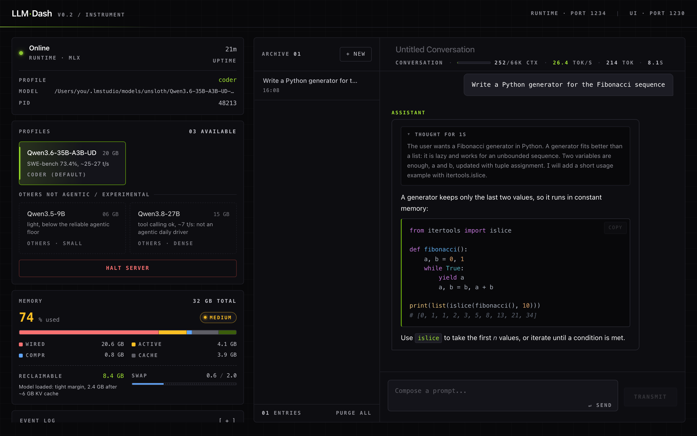

# LLM Dash

**English** · [Italiano](README.it.md)

A control plane and web dashboard for running local LLMs on Apple Silicon with `mlx_lm.server`: named model profiles, one-click switching, a memory pressure monitor and a streaming chat that shows the model's reasoning.



## Why it exists

On a 32 GB Mac only one 16-20 GB model fits at a time, and whether it runs well depends on memory you cannot see from the terminal: wired memory, compression, swap. `mlx_lm.server` is the fastest runtime here (about 5-15% faster than LM Studio on the same weights, see [docs/ARCHITECTURE.md](docs/ARCHITECTURE.md)), but it has no model management and no UI.

LLM Dash adds the missing layer:

- **Profiles** in one TOML file: model path, context, tier, chat template args (for example `enable_thinking`). The same file drives the shell scripts, the dashboard and the opencode setup.
- **Switching** from the browser or the terminal, with one model loaded at a time.
- **Memory**: a breakdown of wired, active, compressed, inactive and free memory, with the macOS pressure level and swap.
- **Chat**: streaming Markdown with syntax highlighting, the model's reasoning in a collapsible box, conversations kept in the browser.

How far this setup goes for agentic coding was measured in a separate repository, **[local-llm-eval](https://github.com/essedev/local-llm-eval)**: which models hold an agentic loop, where 4-bit quantization starts corrupting output, how a local model compares with cloud models on small tasks. Summary in [docs/EVALS.md](docs/EVALS.md).

## Requirements

- Apple Silicon Mac. Built and measured on a MacBook Pro M5 with 32 GB, macOS 26 Tahoe.
- [uv](https://docs.astral.sh/uv/) and `mlx-lm`: `uv tool install mlx-lm`.
- [pnpm](https://pnpm.io/) to build the CSS.
- MLX models under `~/.lmstudio/models/` (downloaded with LM Studio or `huggingface-cli`). The folder is `server.models_dir` in `config/llm-dash.toml`.
- Optional: tmux (`llm-up` runs the server in a tmux session when available), [opencode](https://opencode.ai) as the coding agent.

## Installation

```bash
make setup                   # symlink bin/ scripts into ~/.local/bin + build CSS

# Wired memory limit, once (needs sudo)
sudo sysctl iogpu.wired_limit_mb=28000
# Persistent across reboots:
sudo cp config/com.local.wired-limit.plist /Library/LaunchDaemons/
sudo launchctl load /Library/LaunchDaemons/com.local.wired-limit.plist

# opencode, optional: replace /Users/you with your home
cp config/opencode.json.example ~/.config/opencode/opencode.json
```

Then put your models in `config/llm-dash.toml`. The profiles in the repo are the author's; `docs/MODEL_SYNC.md` is a prompt that lets a coding agent realign the TOML, the opencode config and the docs with the models actually on disk.

## Usage

```bash
llm-up                       # start the default profile on port 1234
llm-dash --bg                # start the dashboard on port 1230
open http://127.0.0.1:1230
```

| Command | What it does |
|---|---|
| `llm-up [profile]` | Start `mlx_lm.server` with a profile (default: `server.default_profile`) |
| `llm-switch <profile>` | Switch model (kill + restart) |
| `llm-down` | Stop the LLM server |
| `llm-dash` | Dashboard in the foreground |
| `llm-dash --bg` | Dashboard in the background |
| `llm-dash stop` | Stop the dashboard |
| `make models` | List the profiles |
| `make help` | Every make target |

Every profile serves an OpenAI-compatible API on `http://127.0.0.1:1234/v1`.

## Documentation

| Document | Content |
|---|---|
| [docs/ARCHITECTURE.md](docs/ARCHITECTURE.md) | Technical decisions: mlx_lm vs LM Studio, one model at a time, SSE vs WebSocket |
| [docs/DASHBOARD.md](docs/DASHBOARD.md) | UI stack, endpoints, streaming render, CSS classes |
| [docs/MODELS.md](docs/MODELS.md) | Model catalog by tier, rankings, benchmarks |
| [docs/MODEL_SYNC.md](docs/MODEL_SYNC.md) | Prompt for a coding agent that realigns models on disk and config |
| [docs/MEMORY.md](docs/MEMORY.md) | available vs used, KV cache, swap, headroom budget |
| [docs/HARDWARE.md](docs/HARDWARE.md) | M5, unified memory, Neural Accelerators, wired limit |
| [docs/OPENCODE.md](docs/OPENCODE.md) | opencode integration, mlx provider |
| [docs/RUNBOOK.md](docs/RUNBOOK.md) | Daily workflow, troubleshooting, recovery |
| [docs/EVALS.md](docs/EVALS.md) | Experiments on the real limits of this setup |
| [docs/CONVENTIONS.md](docs/CONVENTIONS.md) | Language, glossary, code conventions |

## Stack

- **Backend**: Python 3.12 with uv, FastAPI, uvicorn, httpx, psutil, sse-starlette, Jinja2.
- **Frontend**: Tailwind CSS v4 (CSS-first via `@theme`), Alpine.js 3.14, marked, highlight.js, served as static files with no JS bundler.
- **LLM runtime**: mlx-lm 0.31 on Apple MLX.

## Status

A personal tool, used daily on one machine and shared as a reference. It assumes macOS, Apple Silicon and the paths above; there are no releases and no automated tests.

## License

[MIT](LICENSE). The bundled Alpine.js, marked and highlight.js keep their own licenses, listed at the top of `LICENSE`.
